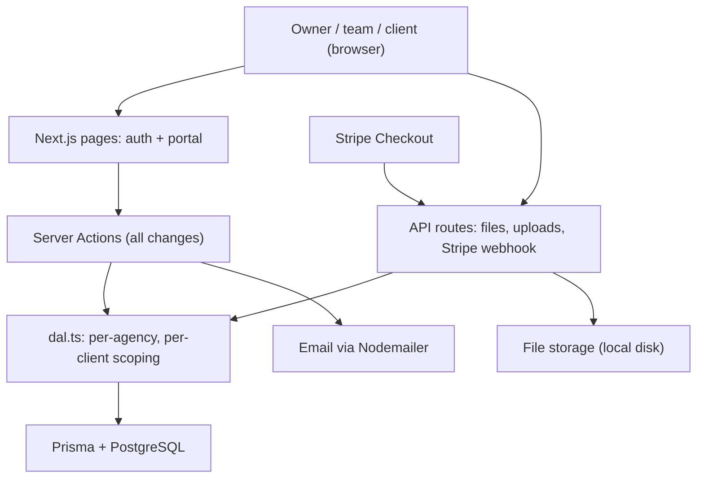

# ClientDesk - a client portal where small agencies share work, get approvals and get paid

## The problem
Small agencies run each client over email threads, shared drives and separate invoicing tools. Files get lost, approvals hide in inboxes, and nobody can see at a glance what is overdue. Clients want one place to see their projects, sign off on work and pay.

## What I built
ClientDesk is a multi-tenant web app with three roles:
- **Agency owners** sign up, create their agency, invite their team and clients by email, connect Stripe and set the currency.
- **Team members** create projects, upload deliverables for review, and send invoices.
- **Clients** log in to see only their own projects, download files, approve a deliverable or request changes, and pay open invoices by card.

A dashboard shows revenue collected by month, outstanding and overdue balances, project status, deliverables waiting for review and recent activity. Emails go out for invitations, new invoices, review requests, review decisions and payments.

## How it works
Pages use the Next.js App Router; every change goes through Server Actions, and file uploads, downloads and the Stripe webhook are API routes. All tenant data is read through scope helpers in `src/lib/dal.ts`, so a query can only return the viewer's own agency (or, for a client, their own company). Prisma talks to PostgreSQL. Files are stored on disk behind a small storage interface, and payments run through Stripe Checkout.

## Tech stack
- **Languages:** TypeScript
- **Frameworks:** Next.js 16 (App Router, Server Actions), React 19, Tailwind CSS 4, Zod, Recharts
- **Data:** Prisma 6, PostgreSQL
- **Payments and email:** Stripe Checkout and Stripe Connect (Express accounts), Nodemailer (any SMTP)
- **Quality:** Vitest unit tests, ESLint, `tsc` type checks

## Engineering highlights
- **Tenant isolation in one place:** `requireViewer`, `requireTeam` and `requireOwner` in `src/lib/dal.ts` gate every page and action, and clients only ever see their own company's projects, files and non-draft invoices.
- **Payments that can't double-count:** `settleCheckoutSession` in `src/lib/invoices.ts` is called by both the webhook and the post-checkout redirect, and a conditional OPEN -> PAID update makes it idempotent. In Connect mode, `account.updated` events keep each agency's "can take payments" flag in sync.
- **Safe file serving:** `/api/files/[id]` checks access on every download, and anything that could run script in the browser (HTML, SVG) is always sent as a download with `nosniff`.
- **Careful auth:** bcrypt password hashes; sessions are random 256-bit tokens stored only as SHA-256 hashes in an `httpOnly` cookie; invitations are single-use, bound to an email, stored hashed and expire after 14 days.
- **Correct money:** amounts are stored in minor units, with zero-decimal currencies (like JPY) handled in `src/lib/money.ts`, and invoice numbers are allocated atomically per agency.

## Results
- [add: agencies or clients using it, or a live demo link]
- [add: invoices or payments processed]
- Unit tests for money, forms and helpers (Vitest).

## Skills shown
Next.js, React, TypeScript, Server Actions, Prisma, PostgreSQL, Stripe payments, Stripe Connect, webhooks, multi-tenant SaaS, authentication and sessions, role-based access control, file uploads, Tailwind CSS, SaaS dashboards, Vitest
