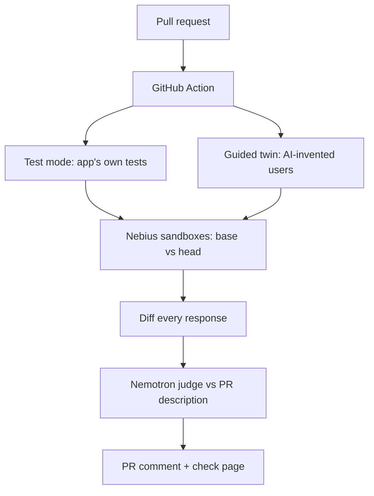

# Doppel - a GitHub check that runs every pull request against main and proves each regression

## The problem
Tests check only what someone thought to assert; reviewers read the diff and guess. A one-line schema change in microblog-api, a well-tested Flask app, leaked every user's password hash, yet all 44 tests passed and an AI code review called it "safe". Teams need to see what a PR actually *does* before it merges.

## What I built
Doppel is a GitHub Action for Flask, Django and FastAPI apps. On every pull request it:
- runs the old and new versions of the app side by side in sandboxes and sends the same requests to both
- compares every response and shows each change as evidence: the request, the old answer and the new answer
- asks an AI judge whether each change is announced in the PR description, so reviewers see only the changes nobody mentioned
- posts one comment on the PR and fails the check when it finds a regression, with a full check page behind it

Test mode needs no setup: it finds the test command in `tox.ini`, CI, a Makefile or a noxfile.

## How it works
`doppel check` runs two modes at once. **Test mode** rides the app's own test suite on base, base again (to learn what is noise) and head, and records every request. The **guided twin** has an AI reviewer list what the PR might break, then Nemotron invents users that probe those spots and replays them in both worlds. A coverage-style tracer confirms the users actually reached the changed lines. Findings from both modes are grouped, judged against the PR description, and turned into one report.

## Tech stack
- **Language:** Python 3.11+, mostly standard library
- **Infra/DevOps:** GitHub Actions (published action), Nebius ConTree sandboxes, a local process backend, GitHub REST API
- **AI/ML:** NVIDIA Nemotron models (via the OpenAI SDK) for persona generation, PR review, setup repair and judging
- **Testing:** pytest, ruff; benchmark workflows run on GitHub runners

## Engineering highlights
- **Noise calibration:** in test mode, base runs twice, so any field that differs between two identical runs (timestamps, ids) is ignored instead of reported (`traffic.py`, `bootstrap.py`).
- **Proof of reach:** `reach.py` injects a `sitecustomize.py` tracer that records whether any user executed the changed lines, so "no differences" is only claimed when the changed code actually ran.
- **Self-healing setup:** `doppel init` drafts the config with Nemotron, boots the app and feeds failures back; if drafts keep failing, a bounded agent (`agent.py`, max 20 steps) sets it up in a live sandbox.
- **Ground truth over guessing:** `probe_app.py` imports the app as its framework would and reports real routes, database and login flow to the model.
- **Cheap judging:** identical changes are grouped, so the judge rules once per distinct change.

## Results
- On a 30-PR benchmark (20 regressions, 10 safe): Doppel caught **17/20** regressions. **Tests + Doppel caught 20/20**, against 12/20 for the test suite alone. That is about $0.25 and 89 s per PR, with 2/10 false alarms.
- On 10 held-out PRs written after tuning: Doppel caught **7/7** with **0/3** false alarms.
- Zero-setup runs on 30 real open-source apps: it worked on up to 8/10 per set, ran up to 10,214 tests per app, and produced **0 false differences**.
- Live demo PR: flagged the password-hash leak in 38 requests in about a minute, while all 44 tests passed.

## Skills shown
Python, GitHub Actions, CI/CD, DevOps, LLM agents, AI evaluation, sandboxed execution, regression testing, FastAPI, Django, API testing, developer tools
