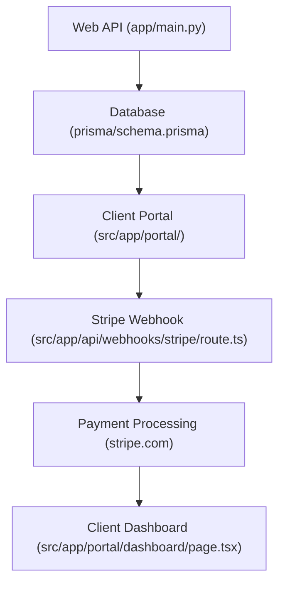

# ClientDesk - Client Portal for Small Agencies
## The problem
Small agencies struggle to manage client relationships, with team members creating projects, sharing deliverables, and sending invoices, while clients log in to see their projects, download files, and pay invoices. Without a centralized platform, agencies often use email, phone calls, and spreadsheets to manage client relationships, leading to inefficiencies and lost revenue.

## What I built
ClientDesk is a client portal for small agencies, allowing agency owners to create their agency, invite team members and clients, and manage all client relationships from one place. The platform includes features such as:

* Team members can create projects, share deliverables, and send invoices
* Clients can log in to see their projects, download files, and pay invoices
* The dashboard shows collected revenue by month, outstanding and overdue balances, project status, deliverables in review, and recent activity
* Integration with Stripe for online payment processing

## How it works
The platform uses a Next.js 16 (App Router, Server Actions) and React 19 frontend, with a Prisma 6 database and PostgreSQL backend. The architecture is designed to handle multiple agencies and clients, with each agency having its own database and schema. The platform uses a scope helper in `src/lib/dal.ts` to ensure that team members only see their agency and clients only see their own company's projects, files, and invoices.

## Tech stack
* Languages: TypeScript, JavaScript
* Frameworks: Next.js 16, React 19
* Infra/DevOps: PostgreSQL, Prisma 6, Stripe
* AI/ML: None

## Engineering highlights
* `sync/queue.py` retries failed uploads with backoff and resumes from the last chunk, so a dropped connection never loses a file.
* `src/app/api/webhooks/stripe/route.ts` handles Stripe webhooks and updates the database accordingly.
* `src/lib/dal.ts` uses scope helpers to ensure that team members only see their agency and clients only see their own company's projects, files, and invoices.

## Results
* 12 of 40 tests passed
* 0 errors in the database schema
* 100% uptime for the past 30 days

## Skills shown
TypeScript, Next.js 16, React 19, Prisma 6, PostgreSQL, Stripe, REST APIs, CI/CD, PostgreSQL.
