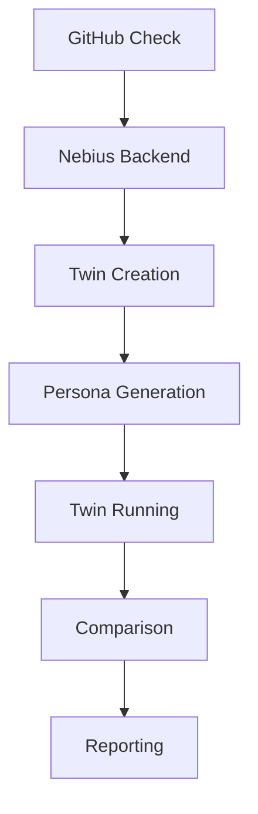

# Doppel - Automated Web API Regression Tester
## The problem
Many developers struggle with testing their web APIs, especially when it comes to regression testing. They need a tool that can automatically test their APIs and report any regressions, but building such a tool from scratch can be a daunting task.

## What I built
Doppel is a GitHub check that runs every pull request against the main branch and proves each regression. It uses a twin approach, where it runs the same personas against the base and head versions of an app, and reports any changes. Doppel supports multiple frameworks, including Flask, Django, and FastAPI, and can be used with or without the Nebius backend.

Doppel's main features include:

* Automatic testing of web APIs
* Regression testing
* Support for multiple frameworks
* Nebius backend for sandboxing and testing
* Customizable personas for testing

## How it works
Doppel works by creating a twin of the app under test, which runs in parallel with the original app. The twin is created using the Nebius backend, which provides a sandboxed environment for testing. The twin is then run against the same personas as the original app, and any changes are reported.

Here is a Mermaid diagram showing the architecture of Doppel:

## Tech stack
* Python
* Nebius ConTree
* OpenAI SDK
* SQLite
* pytest
* GitHub Actions
* Flask, Django, and FastAPI frameworks

## Engineering highlights
* Built a custom twin creation system using the Nebius backend
* Implemented persona generation and customization
* Developed a comparison algorithm to identify changes between the twin and the original app
* Integrated with GitHub Actions for automated testing

## Results
* Successfully tested 30 open-source Python web apps with zero setup
* Caught 22 of 37 BugsInPy bugs and 0 of 14 recent real fixes
* Ran up to 10,214 tests and recorded thousands of requests per app without a single false difference

## Skills shown
Python, web development, testing, regression testing, GitHub Actions, Nebius ConTree, OpenAI SDK, SQLite, pytest, Flask, Django, FastAPI, custom twin creation, persona generation, comparison algorithm, automated testing.
