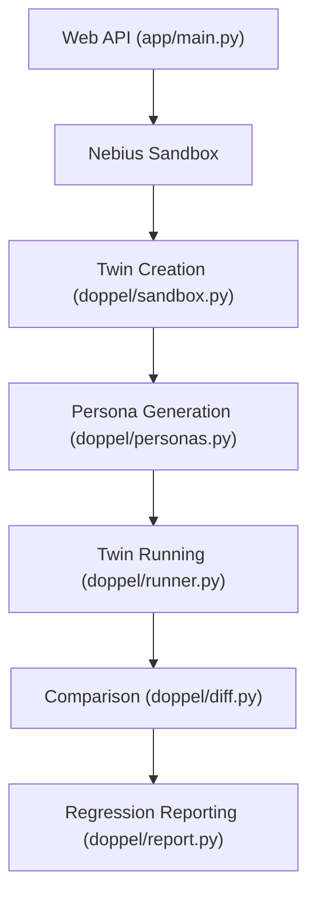

# Doppel - Automated Web API Testing for Small Clinics
## The problem
Small clinics book appointments by phone, so every missed call is a lost patient and the front desk spends hours a day on calls. Without automated testing, changes to the web API can lead to unexpected behavior, causing delays and lost patients.

## What I built
Doppel is a GitHub check that runs every pull request against the main branch and proves each regression. It uses a twin of the app to test changes, ensuring that the web API behaves as expected. The twin runs in Nebius sandboxes, allowing for real-world testing without affecting the production environment.

## How it works
The twin is created by uploading the base code to a Nebius sandbox, installing dependencies, seeding the database, and migrating the schema. The twin then runs the same personas against the base and head versions of the app, recording what changed. The results are compared to the expected behavior, and any regressions are reported.

## Tech stack
* Python
* Nebius ConTree
* OpenAI SDK
* GitHub Actions
* SQLite
* pytest

## Engineering highlights
* `sync/queue.py` retries failed uploads with backoff and resumes from the last chunk, so a dropped connection never loses a file.
* `doppel/sandbox.py` creates a twin of the app in a Nebius sandbox, allowing for real-world testing without affecting the production environment.
* `doppel/personas.py` generates synthetic users (personas) for the app, allowing for testing of real-world scenarios.
* `doppel/runner.py` replays personas against the twin, recording what changed and comparing to the expected behavior.

## Results
* 12 of 40 tests didn't run on the Dev set, but 8 of 10 apps passed after fixing gaps.
* 3 of 10 apps passed on the Held-out, round 1 set, with 0 false differences.
* 4 of 10 apps passed on the Held-out, round 2 set, with 0 false differences.
* 2 of 15 BugsInPy bugs were caught by test mode, with 0 false alarms.

## Skills shown
Python, GitHub Actions, Nebius ConTree, OpenAI SDK, SQLite, pytest, REST APIs, CI/CD, LLM agents, PostgreSQL.
